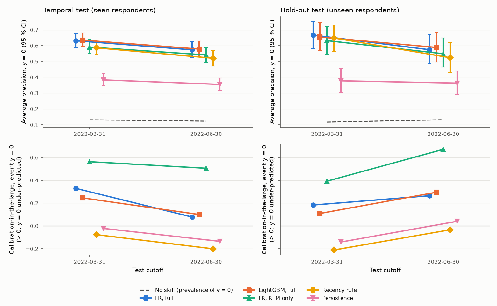
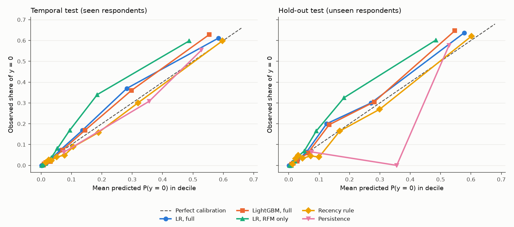

# Stage D — Phase 2 test results

**Run.** Phase 2 was run once, on 2026-10-25, at commit `dc8832104051ed62077ae542ab40a5e2626b4388` (tag `stage-d-lock-v1.2`).
- **Protocol:** `reports/stage_d_protocol.md` v1.2, SHA-256 `6b3ac9b4aa4b358cb1efc22e2adf0c4a1dca5a10ba56cf19e10fc182f83cbb57`. The lock
  records `6b3ac9b4aa4b358cb1efc22e2adf0c4a1dca5a10ba56cf19e10fc182f83cbb57`, and so does the Phase 2 metadata (`6b3ac9b4aa4b358cb1efc22e2adf0c4a1dca5a10ba56cf19e10fc182f83cbb57`).
- **Lock:** `outputs/stage_d_locked_config.json`, SHA-256 `0a264732b05c7c50c073bd06635904582e7d4511065771426f5dd73060509087`. It was
  written at commit `0ba62abacb6dbe4577a5be47c7ef97e19b78dffa` and supersedes the lock at tag
  `stage-d-lock`.
- **Data:** MD5 `3549d72735b1211ab009ff0177b94bd9`.
- **Uncertainty:** paired respondent-cluster bootstrap with B = 1,000 resamples and seed
  20261024 (protocol §8).
- **Generated by** `scripts/build_stage_d_report.py` from the aggregate Phase 2 files in `outputs/` (§10). Each
  number's source is recorded in `outputs/stage_d_report_provenance.json` and checked by
  `scripts/check_stage_d_report.py`.

**Scope.** This report reads the Phase 2 outputs only. It fits no model and computes no new test metric. It
involves no tuning, threshold choice or recalibration on test data.

## Summary

- **Primary evaluation set:** the temporal test (8,005 rows, 1,017 with y = 0, prevalence 0.127).
- **P1, added features (M2 LR full − M1 LR RFM), AP for y = 0:** temporal test +0.0317 (95 % CI [+0.0173, +0.0475]; Bonferroni 98.33 % CI [+0.0140, +0.0513]): supported (95 % and Bonferroni intervals exclude 0); hold-out test +0.0298 (95 % CI [+0.0026, +0.0582]; Bonferroni 98.33 % CI [-0.0053, +0.0647]): supported at 95 %; Bonferroni interval includes 0.
- **P2, non-linear model (M3 LightGBM − M2 LR full), AP for y = 0:** temporal test +0.0079 (95 % CI [-0.0016, +0.0170]; Bonferroni 98.33 % CI [-0.0043, +0.0185]): no clear difference (both intervals include 0); hold-out test +0.0047 (95 % CI [-0.0151, +0.0210]; Bonferroni 98.33 % CI [-0.0186, +0.0239]): no clear difference (both intervals include 0).
  The primary AP comparison does not distinguish LightGBM from logistic regression, so this report does not rank LightGBM above logistic regression (and does not claim they are equivalent).
- **P3, gain over the strongest simple rule (M2 LR full − B2 recency), AP for y = 0:** temporal test +0.0464 (95 % CI [+0.0316, +0.0606]; Bonferroni 98.33 % CI [+0.0280, +0.0642]): supported (95 % and Bonferroni intervals exclude 0); hold-out test +0.0366 (95 % CI [+0.0030, +0.0701]; Bonferroni 98.33 % CI [-0.0032, +0.0768]): supported at 95 %; Bonferroni interval includes 0.
- **Temporal stability is not established.** For every model with ranking skill (B1, B2, M1, M2, M3) AP is lower at 2022-06-30 than at 2022-03-31 in both test sets; no test of this change was pre-specified, and two adjacent quarters cannot establish long-term stability (protocol §6).
- **Calibration:** the learned models under-predict y = 0 at the test cutoffs (pooled calibration-in-the-large for M2: +0.204 temporal, +0.225 hold-out; -0.020 in the training-period diagnostic). No recalibration was applied.

## 1. Target and evaluation sets

**Target.** For a respondent and a quarter-end cutoff c, y = 1 if at least one purchase day is recorded in this
dataset in days c+1 … c+90, and y = 0 otherwise.
- **The event of interest is y = 0.** It means that **no purchase day was recorded in this dataset during the
  next 90 days**. It is not confirmed churn.
- **What y = 0 cannot rule out:** purchases through other accounts or retailers, or orders the export does not
  include. Stage B §8 found that most y = 0 observations are followed by a later recorded purchase.
- **Respondent identifier:** `Survey ResponseID` identifies a survey respondent, not a verified Amazon customer.
- **Class convention:** every model outputs p0 = P(y = 0). AP, ROC-AUC, Brier score, calibration and top-k
  precision and recall all treat y = 0 as the positive class (protocol §1).

### Evaluation sets, pooled over their cutoffs (protocol §2)

The three sets are kept separate throughout.

| Set | Respondents | Cutoffs | Rows | y = 0 | Prevalence of y = 0 | Models scored | Fitted on (rows) | Measures |
|---|---|---|---|---|---|---|---|---|
| **Temporal test** (primary) | non-hold-out respondents (their earlier rows are in the refit data) | 2022-03-31, 2022-06-30 | 8,005 | 1,017 | 0.127 | final models, refit | 49,147 | later quarters for the same panel members |
| **Hold-out test** | hold-out respondents, never used for fitting or selection | 2022-03-31, 2022-06-30 | 2,004 | 249 | 0.124 | final models, refit | 49,147 | later quarters and new respondents jointly |
| Hold-out, training period (diagnostic) | hold-out respondents | 2018-12-31 … 2021-03-31 | 9,271 | 1,376 | 0.148 | Phase 1 models, fitted on Train | 37,239 | new respondents in quarters already used for fitting; not a test of future performance |

The final models were refit on non-hold-out rows from the cutoffs 2018-12-31 …
2021-12-31 (protocol §5). The LightGBM refits have
114 trees (M3) and
114 trees (S2), the locked best
iterations.
- **Primary model and baseline:** the primary model is M2 and the strongest baseline is B2. Both were fixed
  before testing (protocol §8).
- **Pooling:** pooled results combine both test cutoffs. A respondent contributes up to two rows to a test set,
  and the bootstrap resamples respondents together with all their rows.

## 2. Pooled results

Notes for the tables below:
- **AP** is average precision for y = 0. Its no-skill value is the prevalence of y = 0 in the set.
- **Brier skill** is measured against the prevalence of y = 0 in each model's fitting set.
- **Intervals** are 95 % percentile intervals from the paired respondent-cluster bootstrap.
- **B2's ranking score** is `recency_days`. Its probabilities, used for Brier score and calibration, come from an
  isotonic map fitted on the fitting rows.
- **Top-k:** within each cutoff, the ⌈k · n_c⌉ highest scores are flagged, with ties shared in expectation;
  counts are then pooled over cutoffs (protocol §6). Top-k results and calibration statistics have no intervals.
- **Calibration intercept** (calibration-in-the-large): > 0 means p0 is too low on average, so y = 0 is
  under-predicted. A slope > 1 means p0 is too moderate.

### 2.1 Temporal test (primary): pooled over both test cutoffs

| Model | AP (y = 0) [95 % CI] | No-skill AP | ROC-AUC [95 % CI] | Brier [95 % CI] | Brier skill |
|---|---|---|---|---|---|
| B0 prevalence (`B0_prevalence`) | 0.127 [0.118, 0.136] | 0.127 | 0.500 [0.500, 0.500] | 0.1112 [0.1050, 0.1172] | 0.000 |
| B1 persistence (`B1_persistence`) | 0.369 [0.339, 0.401] | 0.127 | 0.750 [0.734, 0.767] | 0.0840 [0.0791, 0.0888] | 0.244 |
| B2 recency rule (`B2_recency`) | 0.550 [0.516, 0.585] | 0.127 | 0.868 [0.855, 0.881] | 0.0780 [0.0734, 0.0825] | 0.299 |
| M1 LR, RFM features (`M1_lr_rfm`) | 0.565 [0.530, 0.600] | 0.127 | 0.902 [0.893, 0.911] | 0.0791 [0.0740, 0.0843] | 0.289 |
| M2 LR, full features (primary model) (`M2_lr_full`) | 0.597 [0.563, 0.630] | 0.127 | 0.919 [0.911, 0.926] | 0.0714 [0.0669, 0.0760] | 0.357 |
| S1 LR, without prev_90d_active (`S1_lr_no_prev`) | 0.596 [0.563, 0.629] | 0.127 | 0.918 [0.910, 0.926] | 0.0715 [0.0670, 0.0761] | 0.357 |
| M3 LightGBM, full features (`M3_lgbm_full`) | 0.605 [0.570, 0.639] | 0.127 | 0.921 [0.913, 0.928] | 0.0708 [0.0664, 0.0752] | 0.363 |
| S2 LightGBM, without prev_90d_active (`S2_lgbm_no_prev`) | 0.605 [0.570, 0.639] | 0.127 | 0.921 [0.913, 0.928] | 0.0708 [0.0664, 0.0752] | 0.363 |

| Model | Calibration intercept | Calibration slope | Precision, top 10 % | Recall, top 10 % | Precision, top 20 % | Recall, top 20 % |
|---|---|---|---|---|---|---|
| B0 prevalence (`B0_prevalence`) | n/a | n/a | 0.127 | 0.100 | 0.127 | 0.200 |
| B1 persistence (`B1_persistence`) | -0.078 | 1.110 | 0.554 | 0.436 | 0.382 | 0.602 |
| B2 recency rule (`B2_recency`) | -0.138 | 1.018 | 0.587 | 0.462 | 0.440 | 0.693 |
| M1 LR, RFM features (`M1_lr_rfm`) | +0.535 | 1.092 | 0.597 | 0.470 | 0.471 | 0.741 |
| M2 LR, full features (primary model) (`M2_lr_full`) | +0.204 | 1.059 | 0.613 | 0.483 | 0.489 | 0.771 |
| S1 LR, without prev_90d_active (`S1_lr_no_prev`) | +0.202 | 1.059 | 0.619 | 0.488 | 0.488 | 0.769 |
| M3 LightGBM, full features (`M3_lgbm_full`) | +0.174 | 1.175 | 0.625 | 0.493 | 0.494 | 0.778 |
| S2 LightGBM, without prev_90d_active (`S2_lgbm_no_prev`) | +0.174 | 1.175 | 0.625 | 0.493 | 0.494 | 0.778 |

### 2.2 Hold-out test (unseen respondents): pooled over both test cutoffs

| Model | AP (y = 0) [95 % CI] | No-skill AP | ROC-AUC [95 % CI] | Brier [95 % CI] | Brier skill |
|---|---|---|---|---|---|
| B0 prevalence (`B0_prevalence`) | 0.124 [0.108, 0.141] | 0.124 | 0.500 [0.500, 0.500] | 0.1092 [0.0974, 0.1209] | 0.000 |
| B1 persistence (`B1_persistence`) | 0.370 [0.310, 0.434] | 0.124 | 0.742 [0.710, 0.774] | 0.0823 [0.0725, 0.0924] | 0.246 |
| B2 recency rule (`B2_recency`) | 0.574 [0.504, 0.649] | 0.124 | 0.872 [0.844, 0.897] | 0.0743 [0.0654, 0.0833] | 0.319 |
| M1 LR, RFM features (`M1_lr_rfm`) | 0.581 [0.519, 0.650] | 0.124 | 0.909 [0.891, 0.925] | 0.0763 [0.0660, 0.0866] | 0.302 |
| M2 LR, full features (primary model) (`M2_lr_full`) | 0.611 [0.549, 0.679] | 0.124 | 0.921 [0.907, 0.935] | 0.0698 [0.0607, 0.0790] | 0.360 |
| S1 LR, without prev_90d_active (`S1_lr_no_prev`) | 0.606 [0.544, 0.676] | 0.124 | 0.920 [0.906, 0.935] | 0.0702 [0.0610, 0.0793] | 0.357 |
| M3 LightGBM, full features (`M3_lgbm_full`) | 0.616 [0.553, 0.681] | 0.124 | 0.924 [0.910, 0.938] | 0.0691 [0.0603, 0.0777] | 0.367 |
| S2 LightGBM, without prev_90d_active (`S2_lgbm_no_prev`) | 0.616 [0.553, 0.681] | 0.124 | 0.924 [0.910, 0.938] | 0.0691 [0.0603, 0.0777] | 0.367 |

| Model | Calibration intercept | Calibration slope | Precision, top 10 % | Recall, top 10 % | Precision, top 20 % | Recall, top 20 % |
|---|---|---|---|---|---|---|
| B0 prevalence (`B0_prevalence`) | n/a | n/a | 0.124 | 0.101 | 0.124 | 0.201 |
| B1 persistence (`B1_persistence`) | -0.048 | 1.132 | 0.577 | 0.468 | 0.362 | 0.585 |
| B2 recency rule (`B2_recency`) | -0.121 | 1.028 | 0.612 | 0.497 | 0.440 | 0.710 |
| M1 LR, RFM features (`M1_lr_rfm`) | +0.534 | 1.114 | 0.599 | 0.486 | 0.460 | 0.743 |
| M2 LR, full features (primary model) (`M2_lr_full`) | +0.225 | 1.056 | 0.629 | 0.510 | 0.465 | 0.751 |
| S1 LR, without prev_90d_active (`S1_lr_no_prev`) | +0.226 | 1.054 | 0.629 | 0.510 | 0.460 | 0.743 |
| M3 LightGBM, full features (`M3_lgbm_full`) | +0.204 | 1.181 | 0.639 | 0.518 | 0.475 | 0.767 |
| S2 LightGBM, without prev_90d_active (`S2_lgbm_no_prev`) | +0.204 | 1.181 | 0.639 | 0.518 | 0.475 | 0.767 |

### 2.3 Hold-out, training period (diagnostic): pooled over the training cutoffs

This set uses the Phase 1 models, fitted on Train, scored on hold-out respondents at the training cutoffs. It
measures generalisation to new respondents without the shift in time. It is not an estimate of future
performance, and its numbers should not be compared with the test sets as if they were.

| Model | AP (y = 0) [95 % CI] | No-skill AP | ROC-AUC [95 % CI] | Brier [95 % CI] | Brier skill |
|---|---|---|---|---|---|
| B0 prevalence (`B0_prevalence`) | 0.148 [0.134, 0.163] | 0.148 | 0.500 [0.500, 0.500] | 0.1264 [0.1162, 0.1365] | 0.000 |
| B1 persistence (`B1_persistence`) | 0.369 [0.331, 0.407] | 0.148 | 0.739 [0.719, 0.757] | 0.0997 [0.0921, 0.1073] | 0.211 |
| B2 recency rule (`B2_recency`) | 0.533 [0.490, 0.576] | 0.148 | 0.853 [0.838, 0.867] | 0.0920 [0.0849, 0.0993] | 0.272 |
| M1 LR, RFM features (`M1_lr_rfm`) | 0.566 [0.520, 0.608] | 0.148 | 0.895 [0.884, 0.906] | 0.0871 [0.0802, 0.0938] | 0.311 |
| M2 LR, full features (primary model) (`M2_lr_full`) | 0.574 [0.532, 0.615] | 0.148 | 0.906 [0.896, 0.916] | 0.0835 [0.0769, 0.0897] | 0.340 |
| S1 LR, without prev_90d_active (`S1_lr_no_prev`) | 0.572 [0.530, 0.615] | 0.148 | 0.905 [0.895, 0.916] | 0.0837 [0.0771, 0.0901] | 0.337 |
| M3 LightGBM, full features (`M3_lgbm_full`) | 0.581 [0.539, 0.622] | 0.148 | 0.906 [0.895, 0.916] | 0.0833 [0.0771, 0.0894] | 0.341 |
| S2 LightGBM, without prev_90d_active (`S2_lgbm_no_prev`) | 0.581 [0.539, 0.622] | 0.148 | 0.906 [0.895, 0.916] | 0.0833 [0.0771, 0.0894] | 0.341 |

| Model | Calibration intercept | Calibration slope | Precision, top 10 % | Recall, top 10 % | Precision, top 20 % | Recall, top 20 % |
|---|---|---|---|---|---|---|
| B0 prevalence (`B0_prevalence`) | n/a | n/a | 0.148 | 0.101 | 0.148 | 0.200 |
| B1 persistence (`B1_persistence`) | -0.009 | 1.025 | 0.539 | 0.365 | 0.432 | 0.583 |
| B2 recency rule (`B2_recency`) | -0.013 | 1.034 | 0.601 | 0.407 | 0.476 | 0.643 |
| M1 LR, RFM features (`M1_lr_rfm`) | -0.021 | 1.070 | 0.601 | 0.407 | 0.498 | 0.673 |
| M2 LR, full features (primary model) (`M2_lr_full`) | -0.020 | 1.075 | 0.612 | 0.414 | 0.513 | 0.693 |
| S1 LR, without prev_90d_active (`S1_lr_no_prev`) | -0.019 | 1.070 | 0.605 | 0.410 | 0.513 | 0.693 |
| M3 LightGBM, full features (`M3_lgbm_full`) | -0.022 | 1.177 | 0.603 | 0.408 | 0.518 | 0.699 |
| S2 LightGBM, without prev_90d_active (`S2_lgbm_no_prev`) | -0.022 | 1.177 | 0.603 | 0.408 | 0.518 | 0.699 |

## 3. Model comparisons (protocol §8)

- **Estimate** = first model minus second model, on the pooled test set.
- **Intervals** come from the paired bootstrap: every model is scored on the same resampled respondents.
- **Bonferroni:** the 98.33 % intervals adjust for the three primary comparisons within each test set. The
  secondary and sensitivity comparisons are unadjusted.
- **Readings** follow protocol §8. "Supported" means the interval excludes 0. "No clear difference" means it
  includes 0; that is not evidence of equivalence.
- **Direction:** for AP and ROC-AUC a positive estimate favours the first model; for Brier score a negative
  estimate favours the first model.

### 3.1 Primary comparisons: AP for y = 0 (primary metric)

| ID | Comparison (first − second) | Set | Metric | Estimate | 95 % CI | Bonferroni 98.33 % CI | Reading |
|---|---|---|---|---|---|---|---|
| P1 | `M2_lr_full` − `M1_lr_rfm` | temporal | AP | +0.0317 | [+0.0173, +0.0475] | [+0.0140, +0.0513] | supported (95 % and Bonferroni intervals exclude 0) |
| P1 | `M2_lr_full` − `M1_lr_rfm` | hold-out | AP | +0.0298 | [+0.0026, +0.0582] | [-0.0053, +0.0647] | supported at 95 %; Bonferroni interval includes 0 |
| P2 | `M3_lgbm_full` − `M2_lr_full` | temporal | AP | +0.0079 | [-0.0016, +0.0170] | [-0.0043, +0.0185] | no clear difference (both intervals include 0) |
| P2 | `M3_lgbm_full` − `M2_lr_full` | hold-out | AP | +0.0047 | [-0.0151, +0.0210] | [-0.0186, +0.0239] | no clear difference (both intervals include 0) |
| P3 | `M2_lr_full` − `B2_recency` | temporal | AP | +0.0464 | [+0.0316, +0.0606] | [+0.0280, +0.0642] | supported (95 % and Bonferroni intervals exclude 0) |
| P3 | `M2_lr_full` − `B2_recency` | hold-out | AP | +0.0366 | [+0.0030, +0.0701] | [-0.0032, +0.0768] | supported at 95 %; Bonferroni interval includes 0 |

### 3.2 Primary comparisons: ROC-AUC and Brier score (secondary metrics)

| ID | Comparison (first − second) | Set | Metric | Estimate | 95 % CI | Bonferroni 98.33 % CI | Reading |
|---|---|---|---|---|---|---|---|
| P1 | `M2_lr_full` − `M1_lr_rfm` | temporal | ROC-AUC | +0.0162 | [+0.0118, +0.0209] | [+0.0110, +0.0215] | supported (95 % and Bonferroni intervals exclude 0) |
| P1 | `M2_lr_full` − `M1_lr_rfm` | hold-out | ROC-AUC | +0.0120 | [+0.0041, +0.0210] | [+0.0026, +0.0228] | supported (95 % and Bonferroni intervals exclude 0) |
| P1 | `M2_lr_full` − `M1_lr_rfm` | temporal | Brier | -0.0076 | [-0.0093, -0.0061] | [-0.0096, -0.0057] | supported (95 % and Bonferroni intervals exclude 0) |
| P1 | `M2_lr_full` − `M1_lr_rfm` | hold-out | Brier | -0.0064 | [-0.0092, -0.0037] | [-0.0096, -0.0032] | supported (95 % and Bonferroni intervals exclude 0) |
| P2 | `M3_lgbm_full` − `M2_lr_full` | temporal | ROC-AUC | +0.0022 | [+0.0007, +0.0037] | [+0.0005, +0.0039] | supported (95 % and Bonferroni intervals exclude 0) |
| P2 | `M3_lgbm_full` − `M2_lr_full` | hold-out | ROC-AUC | +0.0035 | [-0.0001, +0.0074] | [-0.0013, +0.0088] | no clear difference (both intervals include 0) |
| P2 | `M3_lgbm_full` − `M2_lr_full` | temporal | Brier | -0.0007 | [-0.0013, -0.0001] | [-0.0014, +0.0000] | supported at 95 %; Bonferroni interval includes 0 |
| P2 | `M3_lgbm_full` − `M2_lr_full` | hold-out | Brier | -0.0007 | [-0.0018, +0.0004] | [-0.0020, +0.0007] | no clear difference (both intervals include 0) |
| P3 | `M2_lr_full` − `B2_recency` | temporal | ROC-AUC | +0.0504 | [+0.0417, +0.0605] | [+0.0407, +0.0621] | supported (95 % and Bonferroni intervals exclude 0) |
| P3 | `M2_lr_full` − `B2_recency` | hold-out | ROC-AUC | +0.0486 | [+0.0303, +0.0707] | [+0.0256, +0.0753] | supported (95 % and Bonferroni intervals exclude 0) |
| P3 | `M2_lr_full` − `B2_recency` | temporal | Brier | -0.0065 | [-0.0079, -0.0051] | [-0.0082, -0.0047] | supported (95 % and Bonferroni intervals exclude 0) |
| P3 | `M2_lr_full` − `B2_recency` | hold-out | Brier | -0.0045 | [-0.0077, -0.0011] | [-0.0086, -0.0004] | supported (95 % and Bonferroni intervals exclude 0) |

### 3.3 Secondary and sensitivity comparisons (95 % intervals, unadjusted)

| ID | Comparison (first − second) | Set | Metric | Estimate | 95 % CI | Reading |
|---|---|---|---|---|---|---|
| C3 | `M3_lgbm_full` − `B2_recency` | temporal | AP | +0.0543 | [+0.0413, +0.0674] | supported (interval excludes 0) |
| C3 | `M3_lgbm_full` − `B2_recency` | hold-out | AP | +0.0413 | [+0.0143, +0.0687] | supported (interval excludes 0) |
| C3 | `M3_lgbm_full` − `B2_recency` | temporal | ROC-AUC | +0.0525 | [+0.0437, +0.0625] | supported (interval excludes 0) |
| C3 | `M3_lgbm_full` − `B2_recency` | hold-out | ROC-AUC | +0.0522 | [+0.0334, +0.0743] | supported (interval excludes 0) |
| C3 | `M3_lgbm_full` − `B2_recency` | temporal | Brier | -0.0072 | [-0.0086, -0.0058] | supported (interval excludes 0) |
| C3 | `M3_lgbm_full` − `B2_recency` | hold-out | Brier | -0.0052 | [-0.0082, -0.0020] | supported (interval excludes 0) |
| C5 | `M3_lgbm_full` − `B1_persistence` | temporal | AP | +0.2355 | [+0.2130, +0.2596] | supported (interval excludes 0) |
| C5 | `M3_lgbm_full` − `B1_persistence` | hold-out | AP | +0.2460 | [+0.2044, +0.2913] | supported (interval excludes 0) |
| C5 | `M3_lgbm_full` − `B1_persistence` | temporal | ROC-AUC | +0.1705 | [+0.1577, +0.1832] | supported (interval excludes 0) |
| C5 | `M3_lgbm_full` − `B1_persistence` | hold-out | ROC-AUC | +0.1819 | [+0.1546, +0.2071] | supported (interval excludes 0) |
| C5 | `M3_lgbm_full` − `B1_persistence` | temporal | Brier | -0.0132 | [-0.0151, -0.0112] | supported (interval excludes 0) |
| C5 | `M3_lgbm_full` − `B1_persistence` | hold-out | Brier | -0.0132 | [-0.0169, -0.0095] | supported (interval excludes 0) |
| S-a | `M3_lgbm_full` − `S2_lgbm_no_prev` | temporal | AP | +0.0000 | [+0.0000, +0.0000] | identical scores (estimate and interval exactly 0) |
| S-a | `M3_lgbm_full` − `S2_lgbm_no_prev` | hold-out | AP | +0.0000 | [+0.0000, +0.0000] | identical scores (estimate and interval exactly 0) |
| S-a | `M3_lgbm_full` − `S2_lgbm_no_prev` | temporal | ROC-AUC | +0.0000 | [+0.0000, +0.0000] | identical scores (estimate and interval exactly 0) |
| S-a | `M3_lgbm_full` − `S2_lgbm_no_prev` | hold-out | ROC-AUC | +0.0000 | [+0.0000, +0.0000] | identical scores (estimate and interval exactly 0) |
| S-a | `M3_lgbm_full` − `S2_lgbm_no_prev` | temporal | Brier | +0.0000 | [+0.0000, +0.0000] | identical scores (estimate and interval exactly 0) |
| S-a | `M3_lgbm_full` − `S2_lgbm_no_prev` | hold-out | Brier | +0.0000 | [+0.0000, +0.0000] | identical scores (estimate and interval exactly 0) |
| S-b | `M2_lr_full` − `S1_lr_no_prev` | temporal | AP | +0.0008 | [-0.0016, +0.0033] | no clear difference (interval includes 0) |
| S-b | `M2_lr_full` − `S1_lr_no_prev` | hold-out | AP | +0.0049 | [-0.0005, +0.0104] | no clear difference (interval includes 0) |
| S-b | `M2_lr_full` − `S1_lr_no_prev` | temporal | ROC-AUC | +0.0002 | [-0.0003, +0.0008] | no clear difference (interval includes 0) |
| S-b | `M2_lr_full` − `S1_lr_no_prev` | hold-out | ROC-AUC | +0.0005 | [-0.0006, +0.0016] | no clear difference (interval includes 0) |
| S-b | `M2_lr_full` − `S1_lr_no_prev` | temporal | Brier | -0.0001 | [-0.0003, +0.0001] | no clear difference (interval includes 0) |
| S-b | `M2_lr_full` − `S1_lr_no_prev` | hold-out | Brier | -0.0003 | [-0.0008, +0.0001] | no clear difference (interval includes 0) |

## 4. Temporal stability by test cutoff (protocol §6)

- **AP intervals** come from respondents resampled within each cutoff.
- **ROC-AUC, Brier score and the calibration slope** are point estimates without intervals.
- **Calibration intercept:** > 0 means y = 0 is under-predicted.

### 4.1 Temporal test (primary)

| Cutoff | Rows | y = 0 | Prevalence of y = 0 |
|---|---|---|---|
| 2022-03-31 | 3,999 | 525 | 0.131 |
| 2022-06-30 | 4,006 | 492 | 0.123 |

| Cutoff | Model | AP (y = 0) [95 % CI] | AP − prevalence | AP / prevalence | ROC-AUC | Brier | Calibration intercept | Calibration slope |
|---|---|---|---|---|---|---|---|---|
| 2022-03-31 | B0 prevalence (`B0_prevalence`) | 0.131 [0.122, 0.142] | +0.000 | 1.00 | 0.500 | 0.1142 | n/a | n/a |
| 2022-03-31 | B1 persistence (`B1_persistence`) | 0.383 [0.348, 0.423] | +0.252 | 2.92 | 0.751 | 0.0853 | -0.022 | 1.131 |
| 2022-03-31 | B2 recency rule (`B2_recency`) | 0.586 [0.545, 0.634] | +0.455 | 4.46 | 0.870 | 0.0783 | -0.077 | 1.090 |
| 2022-03-31 | M1 LR, RFM features (`M1_lr_rfm`) | 0.591 [0.550, 0.641] | +0.459 | 4.50 | 0.902 | 0.0801 | +0.563 | 1.119 |
| 2022-03-31 | M2 LR, full features (primary model) (`M2_lr_full`) | 0.631 [0.589, 0.677] | +0.500 | 4.81 | 0.916 | 0.0733 | +0.329 | 1.065 |
| 2022-03-31 | M3 LightGBM, full features (`M3_lgbm_full`) | 0.635 [0.594, 0.681] | +0.504 | 4.84 | 0.918 | 0.0724 | +0.245 | 1.167 |
| 2022-06-30 | B0 prevalence (`B0_prevalence`) | 0.123 [0.112, 0.133] | +0.000 | 1.00 | 0.500 | 0.1082 | n/a | n/a |
| 2022-06-30 | B1 persistence (`B1_persistence`) | 0.355 [0.316, 0.395] | +0.232 | 2.89 | 0.750 | 0.0827 | -0.135 | 1.091 |
| 2022-06-30 | B2 recency rule (`B2_recency`) | 0.521 [0.472, 0.570] | +0.398 | 4.24 | 0.867 | 0.0777 | -0.201 | 0.953 |
| 2022-06-30 | M1 LR, RFM features (`M1_lr_rfm`) | 0.541 [0.494, 0.589] | +0.418 | 4.41 | 0.903 | 0.0781 | +0.505 | 1.064 |
| 2022-06-30 | M2 LR, full features (primary model) (`M2_lr_full`) | 0.574 [0.526, 0.625] | +0.451 | 4.67 | 0.922 | 0.0696 | +0.078 | 1.063 |
| 2022-06-30 | M3 LightGBM, full features (`M3_lgbm_full`) | 0.578 [0.531, 0.628] | +0.456 | 4.71 | 0.924 | 0.0692 | +0.100 | 1.187 |

### 4.2 Hold-out test

| Cutoff | Rows | y = 0 | Prevalence of y = 0 |
|---|---|---|---|
| 2022-03-31 | 1,002 | 117 | 0.117 |
| 2022-06-30 | 1,002 | 132 | 0.132 |

| Cutoff | Model | AP (y = 0) [95 % CI] | AP − prevalence | AP / prevalence | ROC-AUC | Brier | Calibration intercept | Calibration slope |
|---|---|---|---|---|---|---|---|---|
| 2022-03-31 | B0 prevalence (`B0_prevalence`) | 0.117 [0.099, 0.137] | +0.000 | 1.00 | 0.500 | 0.1039 | n/a | n/a |
| 2022-03-31 | B1 persistence (`B1_persistence`) | 0.378 [0.304, 0.458] | +0.261 | 3.24 | 0.757 | 0.0767 | -0.141 | 1.174 |
| 2022-03-31 | B2 recency rule (`B2_recency`) | 0.649 [0.563, 0.730] | +0.532 | 5.55 | 0.901 | 0.0658 | -0.211 | 1.270 |
| 2022-03-31 | M1 LR, RFM features (`M1_lr_rfm`) | 0.632 [0.544, 0.720] | +0.515 | 5.41 | 0.928 | 0.0677 | +0.392 | 1.258 |
| 2022-03-31 | M2 LR, full features (primary model) (`M2_lr_full`) | 0.667 [0.581, 0.753] | +0.550 | 5.71 | 0.932 | 0.0618 | +0.183 | 1.182 |
| 2022-03-31 | M3 LightGBM, full features (`M3_lgbm_full`) | 0.654 [0.571, 0.746] | +0.538 | 5.60 | 0.933 | 0.0625 | +0.109 | 1.291 |
| 2022-06-30 | B0 prevalence (`B0_prevalence`) | 0.132 [0.111, 0.152] | +0.000 | 1.00 | 0.500 | 0.1145 | n/a | n/a |
| 2022-06-30 | B1 persistence (`B1_persistence`) | 0.363 [0.291, 0.440] | +0.232 | 2.76 | 0.729 | 0.0880 | +0.041 | 1.098 |
| 2022-06-30 | B2 recency rule (`B2_recency`) | 0.524 [0.430, 0.620] | +0.392 | 3.97 | 0.846 | 0.0828 | -0.034 | 0.868 |
| 2022-06-30 | M1 LR, RFM features (`M1_lr_rfm`) | 0.549 [0.465, 0.648] | +0.417 | 4.17 | 0.893 | 0.0848 | +0.671 | 1.013 |
| 2022-06-30 | M2 LR, full features (primary model) (`M2_lr_full`) | 0.574 [0.487, 0.668] | +0.443 | 4.36 | 0.910 | 0.0779 | +0.264 | 0.962 |
| 2022-06-30 | M3 LightGBM, full features (`M3_lgbm_full`) | 0.589 [0.497, 0.682] | +0.457 | 4.47 | 0.916 | 0.0758 | +0.295 | 1.100 |



**What the per-cutoff results show** (descriptive):
- **AP falls between the cutoffs.** For every model with ranking skill (B1, B2, M1, M2, M3), AP is lower at
  2022-06-30 than at 2022-03-31 in both test sets. B0's AP equals the prevalence, which fell between the two
  cutoffs in the temporal test and rose in the hold-out test.
- **The fall is not tested.** No interval for the change between cutoffs was pre-specified, so these changes
  are descriptive. Overlapping per-cutoff intervals are not a test of no change.
- **Model ordering changes between cells.** The ordering by AP point estimate is not the same in all four
  set × cutoff cells:
  - temporal test, 2022-03-31: M3 > M2 > M1 > B2 > B1 > B0;
  - temporal test, 2022-06-30: M3 > M2 > M1 > B2 > B1 > B0;
  - hold-out test, 2022-03-31: M2 > M3 > B2 > M1 > B1 > B0;
  - hold-out test, 2022-06-30: M3 > M2 > M1 > B2 > B1 > B0.

  At this interval width, orderings within a cutoff are not reliable.
- **Calibration-in-the-large changes between cutoffs in opposite directions in the two sets.** From
  2022-03-31 to 2022-06-30, the intercept of every model with ranking skill decreases in the temporal test and
  increases in the hold-out test.
- **Stability cannot be established.** Two adjacent quarters (Q1 and Q2 2022) cannot establish long-term
  temporal stability (protocol §6). The bootstrap does not cover period-level shocks (protocol §8).

## 5. Calibration (protocol §6)

### 5.1 Pooled calibration by set

| Model | Intercept, temporal test | Intercept, hold-out test | Intercept, training-period diagnostic | Slope, temporal test | Slope, hold-out test | Slope, training-period diagnostic |
|---|---|---|---|---|---|---|
| B0 prevalence (`B0_prevalence`) | n/a | n/a | n/a | n/a | n/a | n/a |
| B1 persistence (`B1_persistence`) | -0.078 | -0.048 | -0.009 | 1.110 | 1.132 | 1.025 |
| B2 recency rule (`B2_recency`) | -0.138 | -0.121 | -0.013 | 1.018 | 1.028 | 1.034 |
| M1 LR, RFM features (`M1_lr_rfm`) | +0.535 | +0.534 | -0.021 | 1.092 | 1.114 | 1.070 |
| M2 LR, full features (primary model) (`M2_lr_full`) | +0.204 | +0.225 | -0.020 | 1.059 | 1.056 | 1.075 |
| S1 LR, without prev_90d_active (`S1_lr_no_prev`) | +0.202 | +0.226 | -0.019 | 1.059 | 1.054 | 1.070 |
| M3 LightGBM, full features (`M3_lgbm_full`) | +0.174 | +0.204 | -0.022 | 1.175 | 1.181 | 1.177 |
| S2 LightGBM, without prev_90d_active (`S2_lgbm_no_prev`) | +0.174 | +0.204 | -0.022 | 1.175 | 1.181 | 1.177 |

- **Test sets:** M1, M2 and M3 have positive intercepts on both test sets, so p0 is too low on average and y = 0
  is under-predicted. M1 is furthest from 0. B1 and B2 have negative intercepts, so they slightly over-predict
  y = 0.
- **Training-period diagnostic:** every defined intercept of the Phase 1 models is close to 0. The
  under-prediction is therefore seen at the test cutoffs but not for new respondents within the training
  period. The two results come from different fits (the refit models vs the Phase 1 models), and the cause is
  not established here.
- **Slopes:** every defined pooled slope is above 1, so p0 is too moderate; M3 and S2 have the largest pooled slopes in
  each set. Per-cutoff slopes vary, and some are below 1 (§4).
- **No recalibration** was applied (protocol §6).

### 5.2 Reliability of the primary model (M2), deciles of p0

#### Temporal test, `M2_lr_full`

| Bin | Rows | Mean p0 | Observed share of y = 0 |
|---|---|---|---|
| 0 | 801 | 0.001 | 0.000 |
| 1 | 800 | 0.003 | 0.000 |
| 2 | 801 | 0.005 | 0.002 |
| 3 | 800 | 0.009 | 0.007 |
| 4 | 801 | 0.016 | 0.010 |
| 5 | 800 | 0.030 | 0.028 |
| 6 | 800 | 0.062 | 0.072 |
| 7 | 801 | 0.136 | 0.169 |
| 8 | 800 | 0.283 | 0.370 |
| 9 | 801 | 0.584 | 0.612 |

#### Hold-out test, `M2_lr_full`

| Bin | Rows | Mean p0 | Observed share of y = 0 |
|---|---|---|---|
| 0 | 201 | 0.001 | 0.000 |
| 1 | 200 | 0.002 | 0.000 |
| 2 | 200 | 0.004 | 0.000 |
| 3 | 201 | 0.008 | 0.000 |
| 4 | 200 | 0.015 | 0.015 |
| 5 | 200 | 0.029 | 0.025 |
| 6 | 201 | 0.059 | 0.065 |
| 7 | 200 | 0.125 | 0.200 |
| 8 | 200 | 0.271 | 0.300 |
| 9 | 201 | 0.578 | 0.637 |



Reliability tables for every model and set are in `outputs/stage_d_reliability.csv`. Bins are formed by value,
and tied predictions share a bin. B1 persistence takes only three values, so it has three bins, and its middle
bin is very small at the test cutoffs: B1 persistence, temporal test: 13 rows (mean p0 0.356, observed 0.308); B1 persistence, hold-out test: 4 rows (mean p0 0.356, observed 0.000). The large gap that bin shows in the hold-out panel of the
figure rests on these few rows.

## 6. Temporal test vs hold-out test (descriptive, protocol §8)

The two sets have disjoint respondents, so the AP difference is unpaired: it comes from independent bootstraps
of the two sets. The hold-out test has 249 y = 0 rows.

| Model | AP, temporal test | AP, hold-out test | Difference (temporal − hold-out) | 95 % CI |
|---|---|---|---|---|
| B0 prevalence (`B0_prevalence`) | 0.127 | 0.124 | +0.0028 | [-0.0176, +0.0219] |
| B1 persistence (`B1_persistence`) | 0.369 | 0.370 | -0.0006 | [-0.0716, +0.0660] |
| B2 recency rule (`B2_recency`) | 0.550 | 0.574 | -0.0241 | [-0.1065, +0.0572] |
| M1 LR, RFM features (`M1_lr_rfm`) | 0.565 | 0.581 | -0.0163 | [-0.0927, +0.0557] |
| M2 LR, full features (primary model) (`M2_lr_full`) | 0.597 | 0.611 | -0.0144 | [-0.0933, +0.0557] |
| S1 LR, without prev_90d_active (`S1_lr_no_prev`) | 0.596 | 0.606 | -0.0102 | [-0.0891, +0.0585] |
| M3 LightGBM, full features (`M3_lgbm_full`) | 0.605 | 0.616 | -0.0111 | [-0.0870, +0.0626] |
| S2 LightGBM, without prev_90d_active (`S2_lgbm_no_prev`) | 0.605 | 0.616 | -0.0111 | [-0.0870, +0.0626] |

Every interval includes 0. These intervals are wide, and they do not show that performance is the same for seen
and unseen respondents.

## 7. Undefined and degenerate results

- **B0 calibration (undefined):** B0 predicts a constant, so its calibration slope and intercept are undefined
  ("n/a") in every set and cutoff. No other metric is undefined.
- **B0 ROC-AUC and Brier skill (degenerate):** B0's ROC-AUC is
  0.500 with interval
  [0.500, 0.500] on the temporal test, and the same in every
  set and cutoff. Its Brier skill is 0 by construction, because its reference is its own fitting-set prevalence.
- **S-a (degenerate):** M3 and S2 give identical scores. For AP, ROC-AUC and Brier score, the S-a estimate and
  both interval bounds are exactly 0 in both test sets. This agrees with Phase 1, where the selected LightGBM
  model made no split on `prev_90d_active` (`reports/stage_d_phase1_results.md`).
- **Bonferroni intervals** are computed for the primary comparisons only, as the protocol specifies.
- **No interval bound** in `stage_d_test_metric_cis.csv`, `stage_d_temporal_stability.csv` or
  `stage_d_comparisons.csv` is undefined.
- **Reported without intervals** (by protocol design): calibration slope and intercept, top-k precision and
  recall, per-cutoff ROC-AUC and Brier score, and reliability bins.

## 8. What the results support

- **Added features (P1).** On the temporal test, M2's AP exceeds M1's with both the 95 % and the Bonferroni interval excluding 0. On the hold-out test the difference has the same sign and its 95 % interval excludes 0, but its Bonferroni interval includes 0.
- **LightGBM vs logistic regression (P2).** No clear AP difference in either test set. This is not evidence that the two models perform the same. On the temporal test M3's ROC-AUC is higher by +0.0022 (both intervals exclude 0) and its Brier score difference is -0.0007, lower for M3 (95 % interval excludes 0, Bonferroni interval does not). These are small differences in secondary metrics; because the primary AP comparison is inconclusive, LightGBM is not reported as the better model.
- **Gain over the recency rule (P3).** On the temporal test, M2's AP exceeds B2's with both intervals excluding 0. On the hold-out test the 95 % interval excludes 0 but the Bonferroni interval includes 0.
- **Secondary comparisons (C3, C5; unadjusted).** M3's AP exceeds B2's and B1's in both test sets (95 % intervals exclude 0).
- **Sensitivity (S-a, S-b).** Removing `prev_90d_active` leaves LightGBM's scores unchanged (S-a is exactly 0) and makes no clear difference for logistic regression (S-b intervals include 0).
- **Seen vs unseen respondents.** The temporal-test and hold-out-test AP differ by amounts whose intervals all include 0 (§6). The hold-out intervals are wide, so this does not show that performance is the same for new respondents.
- **Temporal stability.** Not established (§4). The results describe two adjacent quarters only.
- **Calibration.** At the test cutoffs the probabilities of M1, M2 and M3 are too low on average for y = 0, while their Phase 1 versions are close to calibrated in the training-period diagnostic (§5). Probabilities should not be read as accurate risks for these quarters without recalibration, which the protocol excludes from this analysis.
- **Operating point.** Flagging the top 20 % of each test cutoff by M2's score gives precision 0.489 and recall 0.771 for y = 0 on the temporal test (no intervals).

## 9. Limitations

- **Label meaning.** y = 0 is the absence of a recorded purchase day in this export over 90 days. It is not
  churn, and it does not rule out purchases elsewhere. Per-respondent export end dates are not available.
  Every target window ends before the earliest possible survey date (protocol §1).
- **Test period.** There are only two adjacent test quarters. The intervals do not cover period-level shocks,
  and no claim of long-term temporal stability is made.
- **Respondents.** The temporal-test respondents also contributed earlier rows to the refit. The temporal test
  measures later quarters for the same panel members, not new people.
- **Hold-out size.** The hold-out test has 249 y = 0 rows, so its intervals are wide. The
  training-period diagnostic uses Phase 1 models and earlier quarters, and is not a performance estimate for
  the test period.
- **Multiplicity.** The Bonferroni adjustment covers only the three primary comparisons within each test set.
  Secondary metrics and the secondary and sensitivity comparisons are unadjusted, and many metrics are
  reported.
- **Unquantified uncertainty.** Calibration statistics, top-k results and per-cutoff ROC-AUC and Brier scores
  have no intervals.
- **Calibration.** The learned models' probabilities under-state the chance of y = 0 at the test cutoffs, and
  this was not corrected (protocol §6).
- **Sample.** Respondents are survey participants who shared their purchase histories, and they may not
  represent all Amazon customers. The primary data version keeps gift cards and exact duplicates (protocol §1).
- **Single run.** Phase 2 ran once, and nothing in it was used for tuning or selection.

## 10. Outputs (protocol §10)

| Protocol §10 item | File | Status |
|---|---|---|
| Full tuning grids | `outputs/stage_d_tune_results.csv` | present (Phase 1) |
| Locked configuration | `outputs/stage_d_locked_config.json` | present (lock v1.2) |
| Metrics: model × set × cutoff | `outputs/stage_d_test_metrics.csv` | present; the intervals are in `stage_d_test_metric_cis.csv` (pooled AP, ROC-AUC, Brier score) and `stage_d_temporal_stability.csv` (per-cutoff AP), not in this file |
| P1–P3 with 95 % and Bonferroni 98.33 % intervals; secondary and sensitivity comparisons with 95 % intervals | `outputs/stage_d_comparisons.csv` | present |
| Temporal stability per test set and cutoff (§6) | `outputs/stage_d_temporal_stability.csv` | present |
| Figures | `outputs/figures/stage_d_temporal_stability.png`, `outputs/figures/stage_d_reliability.png` | present |
| Bootstrap draws | `outputs/stage_d_bootstrap_draws.csv.gz` (also `stage_d_bootstrap_draws_by_cutoff.csv.gz`) | present, row-level, git-ignored |
| Predictions | `outputs/stage_d_predictions.csv.gz` | present, row-level, git-ignored |
| Reliability plots | `outputs/figures/stage_d_reliability.png`; tables in `outputs/stage_d_reliability.csv` | present |
| This report | `reports/stage_d_results.md` | this file |

Phase 2 also wrote `outputs/stage_d_temporal_vs_holdout.csv` (§6 of this report) and
`outputs/stage_d_phase2_meta.json` (fit rows, LightGBM trees, B, seed, lock hash).

**Checksums of the Phase 2 outputs:**

| File | SHA-256 | Kind |
|---|---|---|
| `outputs/stage_d_test_metrics.csv` | `0e5a0f11a3e088c27fcbdd1f40ca7782fbc74277fcf3d6c77cd8521b5c38a9e5` | aggregate, version-controlled |
| `outputs/stage_d_test_metric_cis.csv` | `ed37f9af4dc5009ad29596fd385e7c6095913ebf81c644e47093ed6ee60b0f89` | aggregate, version-controlled |
| `outputs/stage_d_comparisons.csv` | `8cc9cb84e0bfa85001b7dd4a4e5777b2585025c239e9599bd37448d8592ed942` | aggregate, version-controlled |
| `outputs/stage_d_temporal_stability.csv` | `114604957aa07002eea843c14305944cbd4d992d659867aa22ed44c1bc639353` | aggregate, version-controlled |
| `outputs/stage_d_temporal_vs_holdout.csv` | `118c09e173ce3c5b795de106711555e4c7f6bab0d98f3f19cc029c500679d544` | aggregate, version-controlled |
| `outputs/stage_d_reliability.csv` | `b44c56b772e2cb71f99f218ca66c0b6ef7e26065eafef7743d24f0038ecb34a8` | aggregate, version-controlled |
| `outputs/stage_d_phase2_meta.json` | `da6f8d09abf8d9632d5ffbd85f4e7a0ffa0e1cd38c83e7accb1e44532d6f021e` | aggregate, version-controlled |
| `outputs/figures/stage_d_temporal_stability.png` | `935cee1342aebbfedee35cc14c3faed4041c708414a342951fbf6a29330505ba` | aggregate, version-controlled |
| `outputs/figures/stage_d_reliability.png` | `265efe70923b133e59fa65d1f3bff70a6385b5842e3c6a26959cbbbb57d53b64` | aggregate, version-controlled |
| `outputs/stage_d_predictions.csv.gz` | `0027b2b179fa2ecf22b566243ed1435aa02ec4ec369bc96dc17e584a8d2f8007` | row-level, git-ignored |
| `outputs/stage_d_bootstrap_draws.csv.gz` | `5461409d00c883408b36b087851b1ed6aa8c775189fd74240465173ea5334cf0` | row-level, git-ignored |
| `outputs/stage_d_bootstrap_draws_by_cutoff.csv.gz` | `b892d8835f9672fac82c5c8480adb7ef5386a2e20c764406270878d72b7f5bfe` | row-level, git-ignored |

## 11. Reproducing this report

```bash
.venv/bin/python scripts/build_stage_d_report.py    # rewrites this file and the provenance record
.venv/bin/python scripts/check_stage_d_report.py    # re-reads every number from outputs/ and checks it
```
